  <a href="https://clement4-g.github.io/"><b>Visiter le musée-portfolio →</b></a>
  &nbsp;·&nbsp;
  <a href="https://www.linkedin.com/in/cl%C3%A9ment-gast-b7b07129a">LinkedIn</a>

Étudiant en **Master International Business**, je construis des sites web et des outils IA (agents, automatisation, IA hors ligne). Mon portfolio se visite comme un musée : chaque projet est accroché à la place d’un chef-d’œuvre, salle après salle.

### Projets phares

| | Projet | En bref |
|---|---|---|
| ★ | [**Le site de Tethys**](https://clement4-g.github.io/?tableau=tethys) | Site vitrine commandé par le dirigeant pendant mon stage, conçu et mis en ligne en 3 mois. |
| 01 | [**Une IA locale, hors ligne**](https://clement4-g.github.io/?tableau=ia-locale) | Un assistant IA qui tourne sur un portable de 8 Go, sans carte graphique ni Internet. |
| 01 | [**Un coffre piloté par des agents**](https://clement4-g.github.io/?tableau=coffre-agents) | Plus de 850 notes tenues à jour par des agents IA. |
| 02 | [**Un bot de trading en démonstration**](https://clement4-g.github.io/?tableau=bot-trading) | Projet d’apprentissage : chaque idée testée sur l’historique, puis sur des données jamais vues. |

### Outils

### Comment je travaille

Je construis avec des assistants IA, et je le dis. Mon travail : cadrer le besoin, trancher entre les options, vérifier le résultat. Le portfolio en est l’exemple : cahier des charges, plan par étapes, tests automatiques, relecture par un second agent avant publication. [Son code source](https://github.com/Clement4-G/Clement4-G.github.io) est public.

---

**In English:** Master’s student in International Business. I build websites and AI tools (agents, automation, offline AI), with a business-trained eye. I’m looking for an internship. My portfolio is a museum you can walk through: [clement4-g.github.io](https://clement4-g.github.io/?lang=en).
